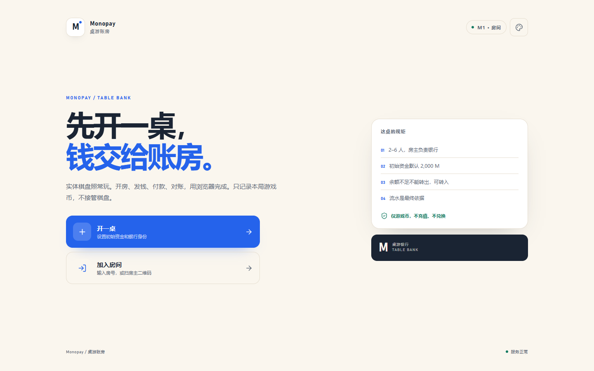

<p align="center">
  
</p>

<h1 align="center">Monopay 桌游账房</h1>

<p align="center">
  只接管钱，不接管棋盘。2–6 人桌游的电子银行账本。
</p>

<p align="center">
  <a href="https://github.com/shanggui/Monopay/actions/workflows/ci.yml"></a>
  
  
</p>

Monopay 是给实体桌游用的电子账本。棋盘、骰子和卡牌照常玩，钱交给它：开桌、发初始资金、付款、退款、银行收款、对账和排名，全部在浏览器完成。手机扫码即可加入，不需要安装 App。



## 功能

- 房主可创建银行-only 或双身份房间，2–6 名玩家通过房号/二维码加入。
- 玩家付款、银行付款/收款、工资、退款、冲正、破产标记和只读结算。
- 每笔流水保留双方交易后余额，支持幂等重试、筛选、分页和详情。
- 六套主题、数字键盘、到账提示、音效/震动，以及移动端适配。
- 仅使用游戏币 **M**，不可充值、提现或兑换现金。

## 用 Docker Compose 部署

### 1. 创建目录并下载文件

```bash
mkdir -p /opt/monopay/{data,backups}
cd /opt/monopay

curl -fsSL \
  -o compose.yaml https://raw.githubusercontent.com/shanggui/Monopay/main/deploy/compose.yaml \
  -o .env https://raw.githubusercontent.com/shanggui/Monopay/main/deploy/.env.example

sudo chown -R 1000:1000 data backups
chmod 600 .env
```

只下载两个文件：

- `compose.yaml`：保持原名。
- `.env.example` 下载时直接改名成 `.env`；Compose 会自动读取。
- `data/`、`backups/`：保持目录名，已经在 compose 里挂载。

Compose 只启动 app。TLS 反向代理由服务器现有服务承担，不包含在 Compose 里。

### 2. 修改 `.env`

```dotenv
PUBLIC_URL=https://monopay.example.com
BIND_ADDR=127.0.0.1
APP_PORT=3000
TRUST_PROXY=true

MONOPAY_IMAGE=ghcr.io/shanggui/monopay
MONOPAY_TAG=v0.1.1
LOG_LEVEL=info
```

`PUBLIC_URL` 必须和浏览器实际访问地址一致，否则二维码和分享链接会指向错误地址。

### 3. 启动

```bash
docker compose pull
docker compose up -d --wait
```

容器只监听 `127.0.0.1:3000`。本机检查：

```bash
curl -fsS http://127.0.0.1:3000/readyz
```

### 4. HTTPS（可选）

应用容器本身只提供 HTTP 3000，证书不放进 app 容器。

**推荐：已有反向代理**

让 Nginx / Traefik 等终止 TLS，把证书挂在反向代理层，再转发到：

```text
https://your-domain.com  →  127.0.0.1:3000
```

`.env` 保持：

```dotenv
PUBLIC_URL=https://your-domain.com
BIND_ADDR=127.0.0.1
TRUST_PROXY=true
```

**直接 IP 访问 / 局域网**

```dotenv
PUBLIC_URL=http://203.0.113.10:3000
BIND_ADDR=0.0.0.0
TRUST_PROXY=false
```

然后放行防火墙 `3000`，访问 `http://203.0.113.10:3000`。

如果确实要“直连容器端口 + HTTPS”，请在容器前增加一个挂载证书的 TLS 终止层，把 443 转发到容器 3000；不要让 app 容器自己处理证书。

### 5. 更新与备份

```bash
docker compose pull
docker compose up -d --wait
```

通过 `.env` 的 `MONOPAY_TAG` 固定版本；回滚时改回旧 tag，再执行上面两条命令。

每日备份：

```bash
docker compose exec app node scripts/backup.mjs
```

备份写入 `./backups`，默认保留 7 天。

> [!IMPORTANT]
> 只运行一个 `app` 副本。房间、余额和 WebSocket 都在单进程内，使用 SQLite，不支持水平扩容。
