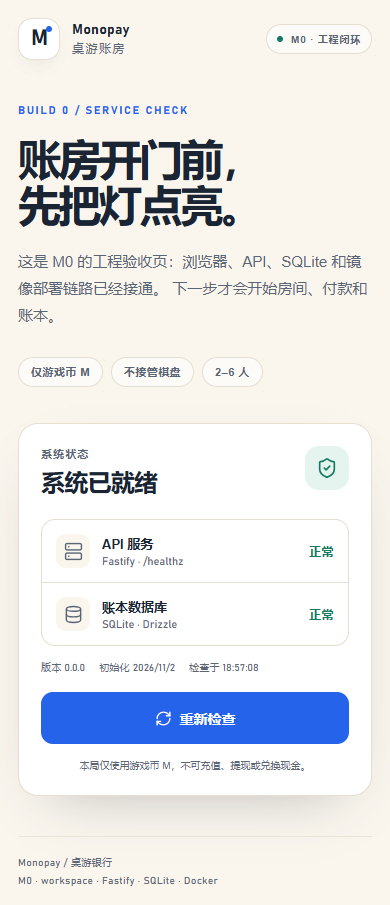
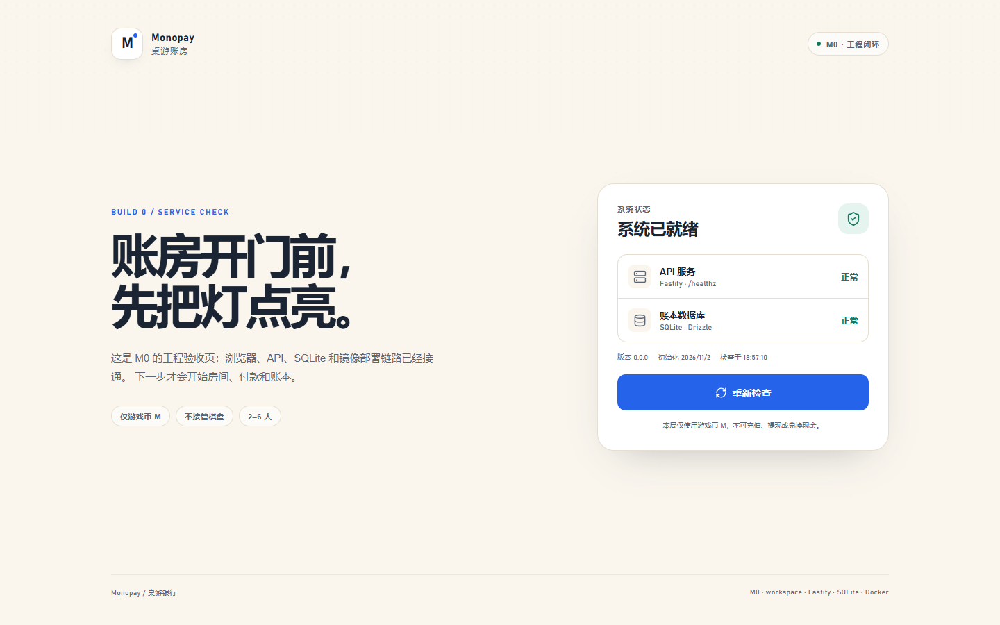

# M0 验收记录

> 日期：2026-11-02 ｜ 阶段：M0 工程与部署闭环
>
> 结论：**本地工程与构建通过；GHCR 首次镜像和服务器 HTTPS 部署待执行，因此 G0 尚未完全关闭。**

---

## 1. 环境

| 项 | 值 |
|---|---|
| 开发机 | Windows |
| Node.js | 24.21.0 |
| pnpm | 12.14.0 |
| 浏览器 | Edge / Playwright Core 1.64.1 |
| 本机 Docker | 未安装 |

---

## 2. 已通过

| 检查 | 命令 | 结果 |
|---|---|---|
| 干净安装 | `pnpm install --frozen-lockfile` | 通过；349 个包，无 build 脚本错误 |
| Lint | `pnpm lint` | 通过 |
| 格式 | `pnpm format:check` | 通过 |
| 类型 | `pnpm typecheck` | Web + Server 通过 |
| 单测 | `pnpm test` | 4/4 通过 |
| 构建 | `pnpm build` | Web + Server 通过 |
| 生产启动 | `node apps/server/dist/index.js` | 通过 |
| 部署产物 | `pnpm deploy --prod` | 可独立启动，`/readyz` 通过 |

构建体积：

```text
Web  dist/index.html                 0.65 kB
     dist/assets/index-*.css       203.67 kB (gzip 54.79 kB)
     dist/assets/HomePage-*.js       7.64 kB
     dist/assets/index-*.js         92.86 kB
Server dist/index.js                6.78 kB
```

> CSS 较大是因为 M0 直接引入了完整 Vant 样式；后续按需引入后再压。

---

## 3. HTTP 冒烟

| 请求 | 结果 |
|---|---|
| `GET /healthz` | 200，返回服务名和版本 |
| `GET /readyz` | 200，SQLite 可用，返回初始化时间 |
| `GET /api/meta` | 200，返回版本/初始化时间 |
| `GET /` | 200，返回 SPA |
| `GET /r/ABC123` | 200，SPA fallback 正常 |
| `GET /api/missing` | 404，JSON 错误 envelope |

示例：

```json
{"ok":true,"data":{"service":"Monopay 桌游账房","version":"0.0.0"},"serverTime":1793617026261}
{"ok":true,"data":{"database":"ok","initializedAt":"2026-11-02T10:51:24.553Z"},"serverTime":1793617026288}
```

---

## 4. 页面验收





| 项 | 结果 |
|---|---|
| 390px 视口 | `scrollWidth=390`，无横向滚动 |
| 1440px 视口 | `scrollWidth=1440`，两栏布局 |
| 默认主题 | A 奶油与钴蓝 |
| 组件 | 余额/银行感纸卡、状态行、主按钮、免责声明 |
| 禁用元素 | 无金币、黄铜、筹码、骰子、赌场绿 |
| 文案 | 使用“银行/桌游账房/游戏币 M”，无“钱庄/充值/提现/兑换” |

截图由 `pnpm screenshot` 生成，使用本机 Edge；其他机器可设 `BROWSER_PATH`。

---

## 5. 已落地的基础设施

- `pnpm-workspace.yaml`：apps + packages。
- `apps/web`：Vue 3 + Vite + TypeScript + Vant + Tailwind + Pinia + Vue Router。
- `apps/server`：Fastify 5 + Zod env + SQLite + Drizzle + 初始迁移 + 静态 SPA。
- `packages/shared`：API envelope、Health/Ready 类型。
- `packages/ledger-core`：空包占位，M2 填充。
- `Dockerfile`：Node 24 多阶段、非 root、`/readyz` healthcheck。
- `deploy/compose.yaml` + `deploy/Caddyfile`：app + Caddy + SQLite volume。
- `.github/workflows/ci.yml`：lint/typecheck/test/build。
- `.github/workflows/docker-publish.yml`：GHCR 推送。
- `README.md`：本地开发、镜像、服务器部署、回滚。

---

## 6. 尚未完成（G0 剩余）

- [ ] 推送 GitHub `main`，确认 `ci` workflow 通过。
- [ ] 确认 `publish-image` 推出 `ghcr.io/shanggui/monopay:sha-...`。
- [ ] GHCR 包改为 Public，或服务器配置 `docker login`。
- [ ] 服务器 `docker compose pull && up -d`。
- [ ] `https://<domain>/readyz` 通过。
- [ ] 重启容器后 SQLite 数据仍在。
- [ ] 回滚到上一个 tag 验证。
- [ ] 服务器 `./data` 权限为 UID 1000。

这些是 M0 的最终 Gate；完成前不进入 M1。

---

## 7. 已知限制

- M0 没有房间、付款、账本、WebSocket。
- 版本仍为 `0.0.0`；首个发布 tag 建议 `v0.1.0`。
- 未在本地构建 Docker 镜像（本机无 Docker）；Dockerfile 通过 `pnpm deploy` 产物和 YAML 检查间接验证，最终以 GitHub Actions + 服务器为准。
- Caddy 需要 80/443 空闲；已有 Nginx 时按 README 去掉 Caddy。
- 完整 Vant CSS 体积偏大，M4 再优化按需引入。
