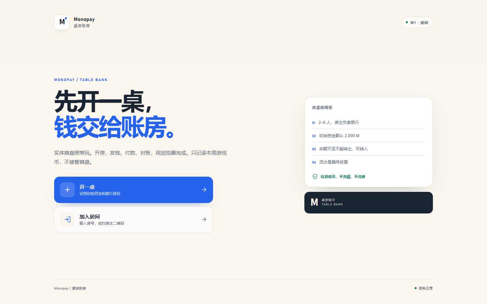
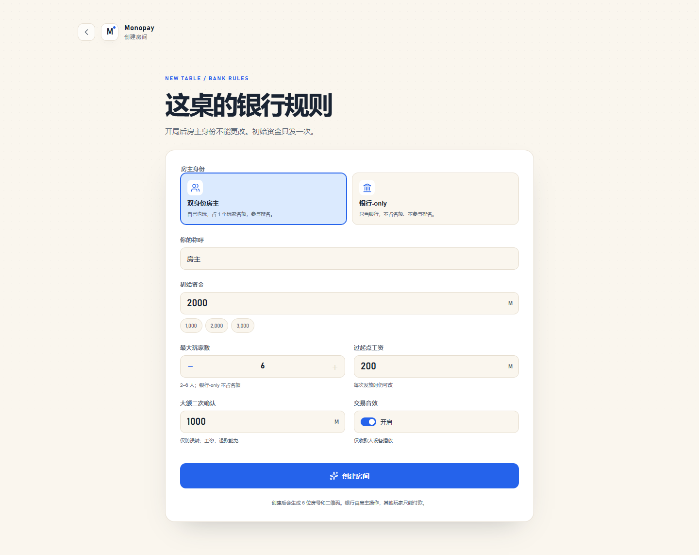
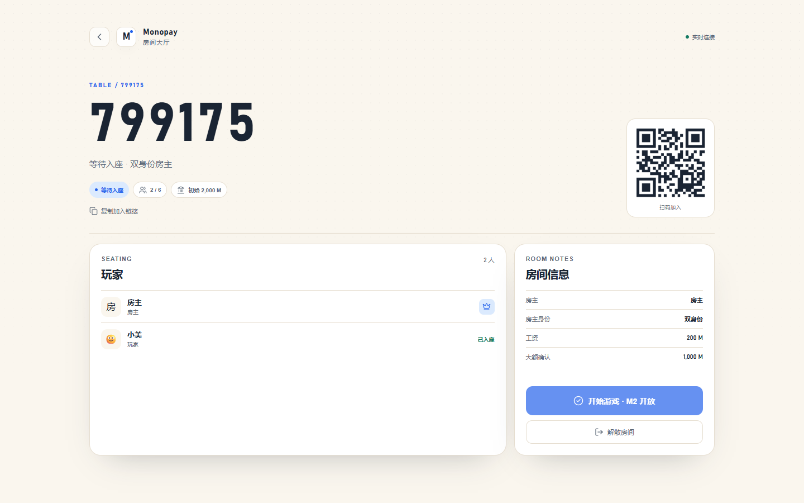
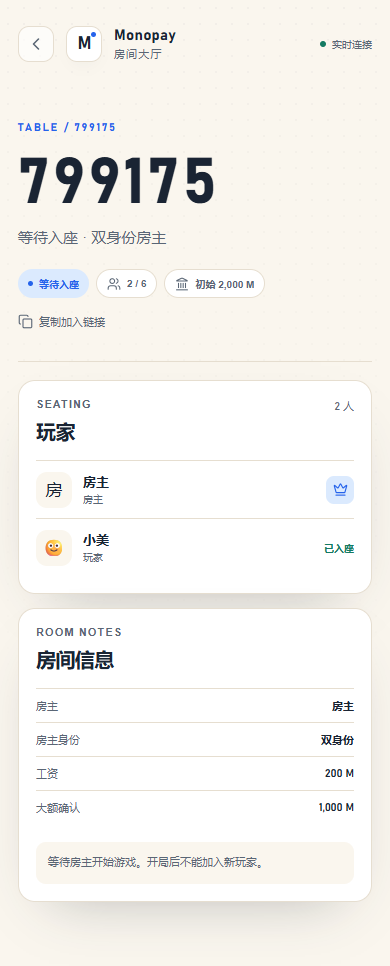
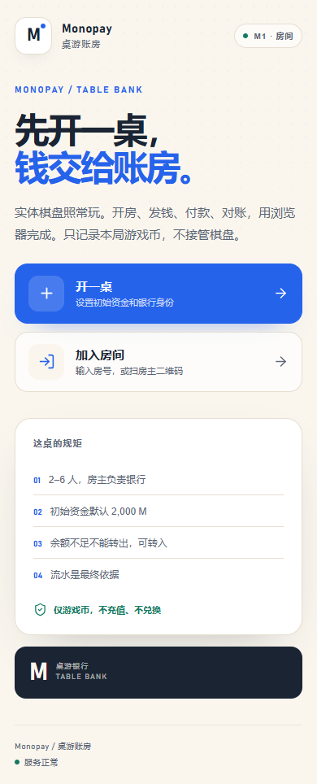
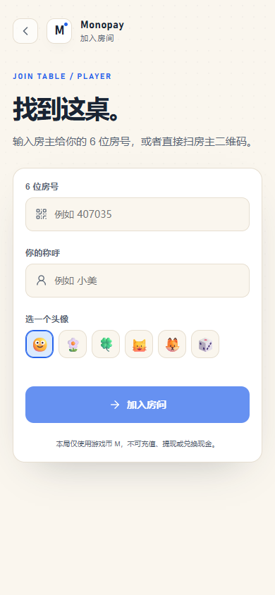

# M1 验收记录

> 日期：2026-11-02 ｜ 阶段：M1 房间生命周期
>
> 结论：**本地 M1 功能通过；服务器部署按用户要求推迟到全部功能完成后统一验证。**

---

## 1. 已完成

| 模块 | 内容 |
|---|---|
| 数据 | `rooms`、`players`、`room_events`；`0001` 迁移 |
| 创建房间 | 6 位房号、银行-only/双身份、配置、hostToken |
| 加入房间 | 昵称/头像、人数上限、银行-only 不占名额、重复凭证重连 |
| 快照 | 房间、房主、自己、玩家列表、`lastSeq` |
| 解散 | 仅房主；立即只读；写房间事件 |
| 过期 | 24 小时无活动自动标记解散 |
| WebSocket | 首帧 `auth`、`ready`、`player_joined`、`room_updated`、ping/pong |
| 前端 | 首页、创建、加入、大厅、二维码、复制链接 |
| 路由 | `/`、`/create`、`/join`、`/r/:code`、`/room/:code` |
| 安全 | token 只存 hash；房间接口 Bearer 校验；房主权限服务端校验 |

---

## 2. 自动测试

```text
pnpm test
  apps/server/src/app.test.ts       4 passed
  apps/server/src/routes/rooms.test.ts 7 passed
  total 11 passed
```

覆盖：

- 双身份房主创建后出现在玩家列表。
- 银行-only 房主不占玩家名额。
- 加入、重连、房间满员。
- 6 人房间，第 7 人拒绝。
- 非房主解散 403，房主解散后 `dissolved`。
- 缺失/错误凭证 401。
- WebSocket 鉴权 + `player_joined` 广播。

---

## 3. 浏览器流程

`pnpm flow:m1`：

```text
创建房间
→ 房主进入大厅
→ 第二个浏览器打开 /r/:code
→ 输入昵称加入
→ 房主实时看到 2 人
→ 房主刷新后仍能恢复
→ 390 / 1440 无横向滚动
→ 0 个控制台错误
```

实测输出：

```text
host players: 2
player players: 2
errors: []
```

### 截图













---

## 4. G1 检查单

- [x] 房主只能创建银行-only/双身份，不能创建纯玩家。
- [x] 创建页默认双身份 / 2,000 M / 6 人 / 200 M / 1,000 M / 音效开。
- [x] 6 名玩家可加入，第 7 名被拒绝；银行-only 不占名额。
- [x] 同一 token 重复加入按重连处理，不重复创建玩家。
- [x] 刷新页面后仍能回到原房间。
- [x] 非房主解散返回 `FORBIDDEN`；房主解散后只读。
- [x] 扫 `/r/CODE` 或输入房号可进入加入页。
- [x] 大厅实时显示新玩家；WS 鉴权、广播通过。
- [x] 390 / 1440 无横向滚动；关键按钮 ≥44px。
- [ ] 开局后新玩家不能加入：**M2 实现 start 后补测**（M1 还没有 start 接口）。
- [ ] 24 小时过期：代码已接入启动/每小时任务，时间旅行测试留到 M5。

---

## 5. 已知限制

- M1 没有开局、初始资金、付款、银行台、流水；这些属于 M2。
- “开始游戏”按钮是禁用占位，标注 M2 开放。
- hostToken/playerToken 存 localStorage；清缓存会丢失，MVP 接受。
- 二维码由客户端生成；`PUBLIC_URL` 必须配置正确。
- 未做加入/付款限流、CSP 收紧；M5 安全阶段处理。
- 单 app 副本；SQLite + 进程内 WS，不支持多副本。
- 服务器 HTTPS、Docker Compose、重启持久化按用户要求推迟到最终阶段。

---

## 6. 下一步

M2：开局 + 初始资金 + 玩家付款 + 银行台 + 工资 + 幂等 + 流水。
