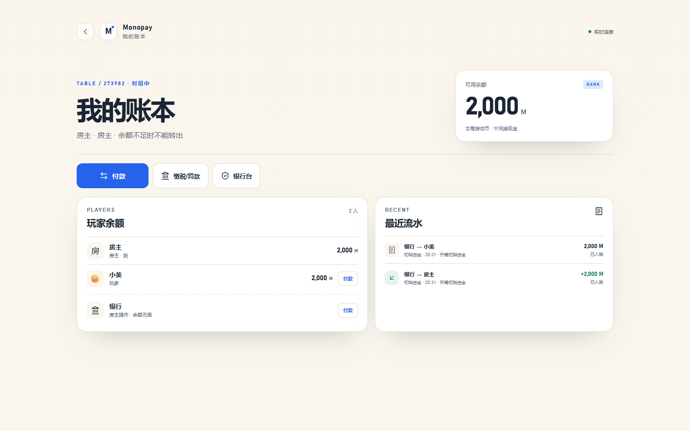
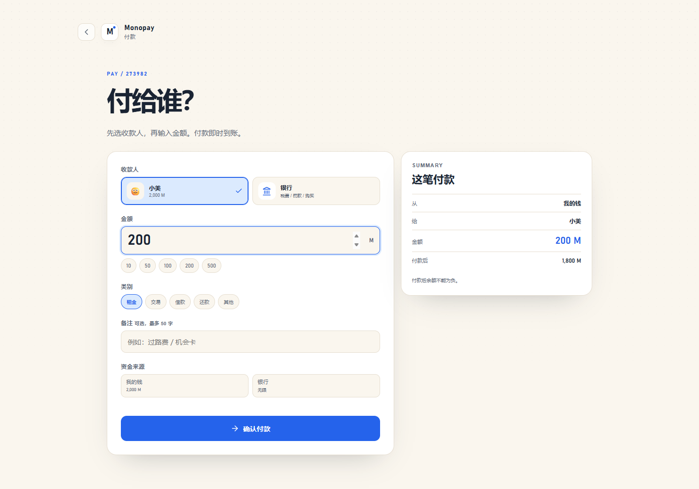
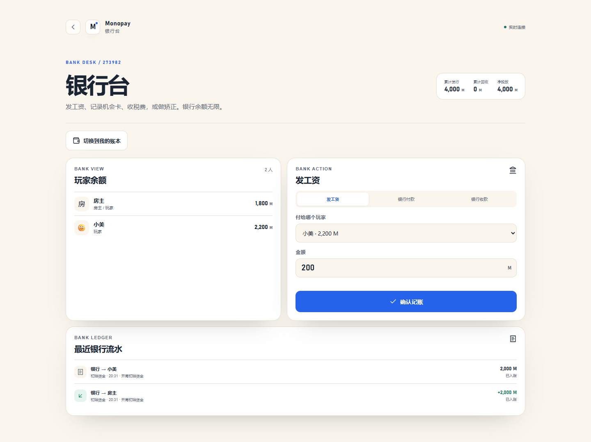
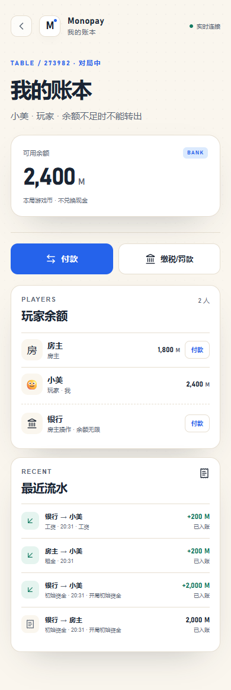
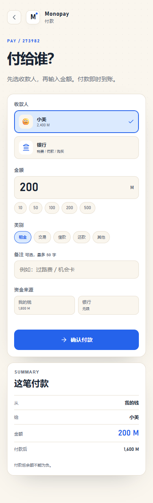
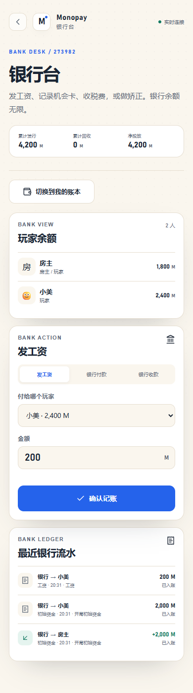

# M2 验收记录

> 日期：2026-11-02 ｜ 阶段：M2 账本核心与付款
>
> 结论：**本地 M2 通过。开局、初始资金、玩家付款、银行付款/收款、工资、幂等、流水和银行台均已可运行；服务器部署仍按计划推迟到最后。**

---

## 1. 已完成

| 模块 | 内容 |
|---|---|
| 账本规则 | `packages/ledger-core`：金额校验、扣款、入账；单测 |
| 数据 | `transactions` 表、`0002` 迁移、房间/交易序号、幂等键唯一 |
| 开局 | 仅房主；至少 2 名玩家；初始资金只发一次；写 `initial` 流水 |
| 玩家付款 | 玩家→玩家、玩家→银行；余额不足拒绝；双身份可切换“我的钱/银行” |
| 银行操作 | 银行付款、银行收款、发工资；仅房主；银行余额无限 |
| 幂等 | `clientRequestId` 唯一；重复请求返回原交易；同键不同参数拒绝 |
| 查询 | 快照带最近流水、玩家余额、累计发行/回收/净投放 |
| 实时 | WS `transaction` 事件；前端自动刷新余额和流水 |
| UI | 我的账本、付款页、银行台；从大厅开始游戏后进入 |
| 大额确认 | 普通付款超过阈值二次确认；工资/退款豁免 |

---

## 2. 自动测试

```text
pnpm test
  ledger-core                       3 passed
  server app                        4 passed
  room lifecycle                    7 passed
  ledger / payment                 10 passed
  total                            24 passed
```

覆盖：

- 初始资金只发一次；重开返回 409。
- 银行-only 房主没有个人余额，不占玩家名额。
- 玩家→玩家：余额、流水、重复请求幂等。
- 玩家→银行：余额减少，累计回收增加。
- 银行付款 / 工资 / 银行收款：余额、累计发行、权限。
- 双身份房主从银行付款，个人余额不变。
- 余额不足、给自己付款、非房主操作银行。
- 6 笔并发付款只成交余额允许的 3 笔，不出现负余额。
- 100 笔付款后余额与流水一致，`seq` 正确。

---

## 3. 浏览器流程

`pnpm flow:m2`：

```text
创建房间
→ 第二名玩家加入
→ 房主开始游戏（发初始资金）
→ 房主进入我的账本
→ 房主付款 200 M 给小美
→ 房主进入银行台
→ 发工资 200 M 给小美
→ 小美余额从 2,000 变为 2,400
→ 390 / 1440 无横向滚动
→ 0 个控制台错误
```

实测：

```text
host transactions: 3
player balance: 2,400 M
errors: []
```

### 截图













---

## 4. G2 检查单

### G2a 账本正确性

- [x] 2–6 人开局，初始资金只发一次。
- [x] 银行-only 没有个人余额；双身份/普通玩家获得初始资金。
- [x] 玩家→玩家、玩家→银行、银行→玩家、工资。
- [x] 余额不足拒绝；收款不受余额限制；银行付款不受限制。
- [x] 双身份“我的钱/银行”来源正确。
- [x] 100 笔付款后余额与流水一致。
- [x] 重复点击/重试不重复扣款。
- [x] 6 人并发不出现负余额；只成交余额允许的部分。
- [x] 每笔余额变化可追溯到流水。
- [x] 银行台累计发行/回收/净投放正确。

### G2b 操作体验

- [x] 付款页：收款人、金额、快捷金额、类别、备注、来源、前后余额。
- [x] 付款成功页；余额不足提示；网络错误提示。
- [x] 银行台只有房主能打开；非房主接口 403。
- [x] 付款人离线时客户端禁用付款；服务端不提供离线排队。
- [x] 大额二次确认（普通付款，工资/退款豁免）。
- [ ] 付款中位时长 ≤8 秒：当前未做正式计时，浏览器流程可完成；M5 用 Playwright 计时。
- [ ] 收款人 1 秒内看到到账：WS `transaction` 已实现；正式延迟测量留到 M5。

---

## 5. 已知限制

- 退款、冲正、矫正、破产、结算属于 M3，尚未实现。
- 音效、到账横幅、震动属于 M4，尚未实现。
- 付款页使用输入框 + 快捷金额，不是最终数字键盘；M4 再统一组件。
- 未做加入/付款限流、CSP 收紧；M5 安全阶段处理。
- 单 app 副本；SQLite + 进程内 WS。
- 服务器 HTTPS、Compose、重启持久化仍待最终验证。

---

## 6. 下一步

M3：退款、冲正、矫正、破产、流水筛选/详情、结算与只读。
