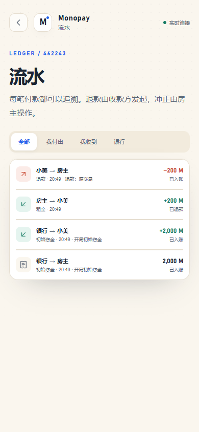
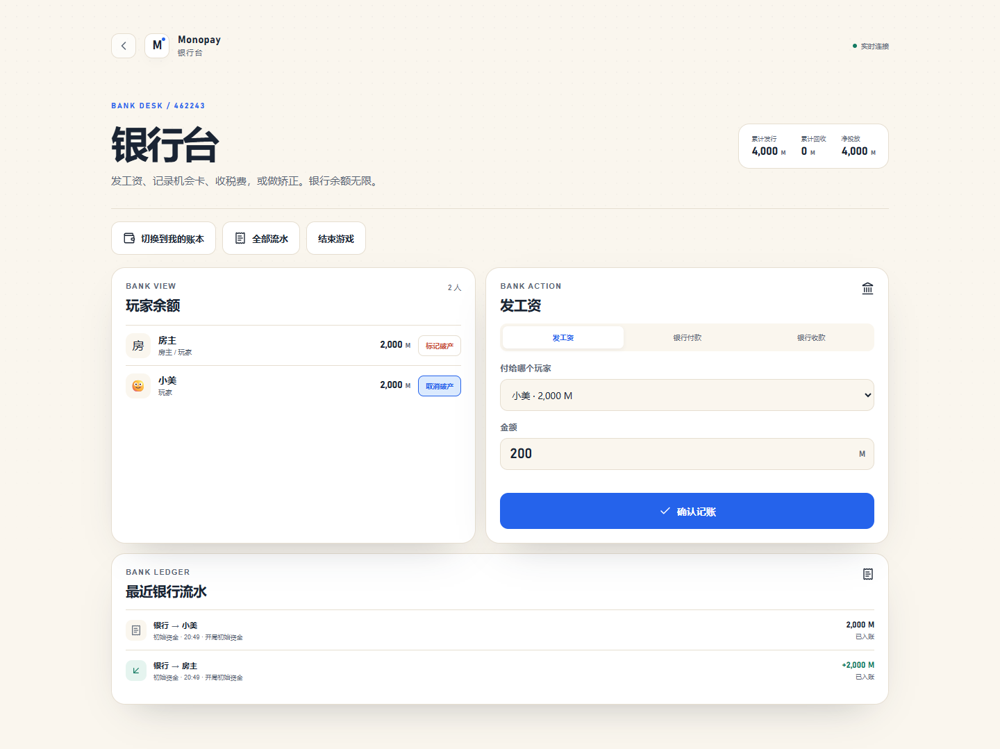
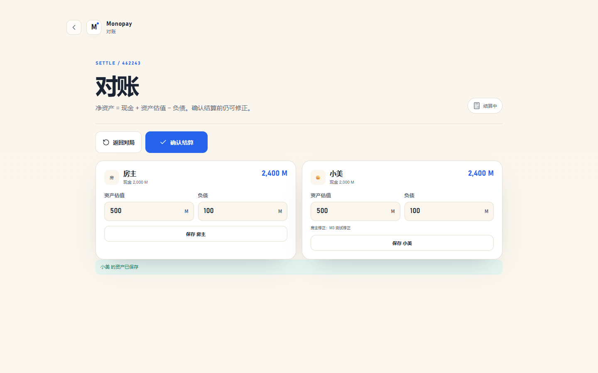
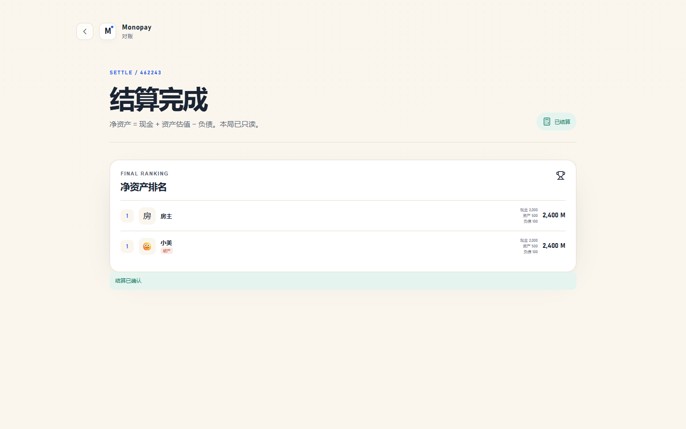
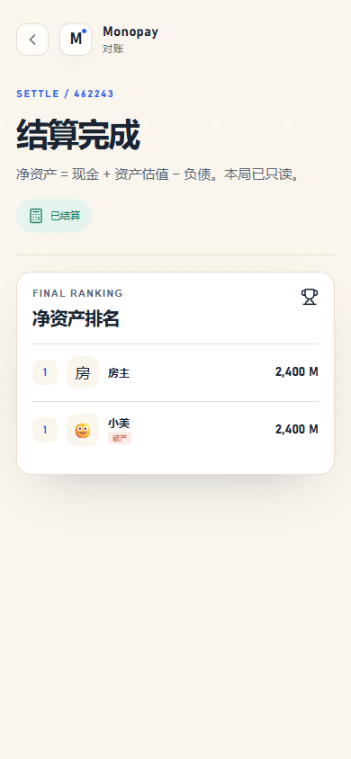

# M3 验收记录

> 日期：2026-11-02 ｜ 阶段：M3 纠错、破产与结算
>
> 结论：**本地 M3 通过。** 退款、冲正、破产、流水筛选/详情、结束游戏、资产对账、排名和只读结算已可运行；服务器部署仍推迟到最后。

---

## 1. 已完成

| 模块 | 内容 |
|---|---|
| 退款 | 收款方发起、全额、原路退回；原交易标记 `refunded`；新交易 `refundOf` |
| 冲正 | 仅房主、必须原因；原交易保留并标记 `reversed`；新交易 `reversalOf` |
| 不可退/不可冲 | 初始资金、退款、冲正；已退款/已冲正再次操作拒绝 |
| 破产 | 房主标记/取消；破产玩家不能主动付款/退款；可被动收款；排名保留破产标记 |
| 流水 | 全部/我付出/我收到/银行；游标分页；详情；退款/冲正入口 |
| 结束游戏 | 房主结束 → `settling`；可返回 `playing` |
| 资产 | 玩家填自己；房主可代填/修正，必须原因；记录修改人 |
| 结算 | 净资产 = 现金 + 资产 − 负债；并列名次；银行-only 房主不参与排名 |
| 只读 | 确认结算 → `settled`；所有写操作拒绝 |
| 实时 | `player_updated`、`settlement`、`room_updated`；前端刷新 |
| 银行流水 | 退款/冲正与原交易不重复计入累计发行/回收 |

---

## 2. 自动测试

```text
pnpm test
  ledger-core                       3 passed
  server app                        4 passed
  room lifecycle                    7 passed
  ledger / payment                 10 passed
  corrections / settlement          9 passed
  total                            33 passed
```

新增覆盖：

- 收款方退款；付款方退款 403；重复退款 409。
- 退款初始资金 409。
- 银行作为收款方退款，累计回收回到 0。
- 房主冲正；非房主 403；重复冲正 409。
- 标记/取消破产；破产后主动付款 403；恢复后可付款。
- 结束游戏、返回对局、确认结算。
- 并列名次；结算后只读。
- 银行-only 房主不进入排名。
- 流水筛选与游标分页。

---

## 3. 浏览器流程

`pnpm flow:m3`：

```text
创建房间 → 加入 → 开始
→ 房主付 200 M 给小美
→ 小美打开流水，退款
→ 房主打开银行台，标记小美破产
→ 结束游戏 → 填资产 → 确认结算
→ 1440 / 390 无横向滚动 → 0 个控制台错误
```

实测：

```text
rank rows: 2
errors: []
```

### 截图











---

## 4. G3 检查单

### G3a 纠错正确性

- [x] 退款由收款方发起，原路、全额。
- [x] 银行作为收款方时由房主发起退款。
- [x] 原交易保留并标记已退款；退款交易关联原交易。
- [x] 冲正仅房主，必须原因；原交易保留并标记已冲正。
- [x] 初始资金、退款、冲正不可再退/再冲。
- [x] 退款/冲正不产生负余额（沿用扣款校验）。
- [x] 重复退款/冲正拒绝。
- [x] 银行累计发行/回收不因退款/冲正重复计算。

### G3b 破产与结算

- [x] 房主标记/取消破产。
- [x] 破产玩家不能主动付款/退款；可被动收款。
- [x] 破产玩家保留在排名并带标记。
- [x] 结束游戏进入结算中；可返回对局。
- [x] 玩家填自己资产；房主代填/修正必须原因。
- [x] 净资产公式正确；并列名次。
- [x] 银行-only 房主不参与排名。
- [x] 确认结算后只读。

### G3c 流水

- [x] 全部/我付出/我收到/银行筛选。
- [x] 游标分页。
- [x] 详情展示双方、金额、类别、备注、状态、关联。
- [x] 退款/冲正入口按角色显示。
- [x] 原交易状态同步更新。

---

## 5. 已知限制

- 音效、震动、主题切换、数字键盘、动效仍是 M4。
- 结算排名是竞争名次（1、2、2、4），不是密集名次。
- 资产只记录“资产估值/负债”，不拆房产/抵押明细。
- 未做正式限流、CSP、备份演练；M5 处理。
- 服务器 HTTPS/Compose/重启持久化仍待最后验证。

---

## 6. 下一步

M4：主题切换、音效与震动、到账反馈、数字键盘、骨架/过渡、重连提示、图标与移动端细节。
