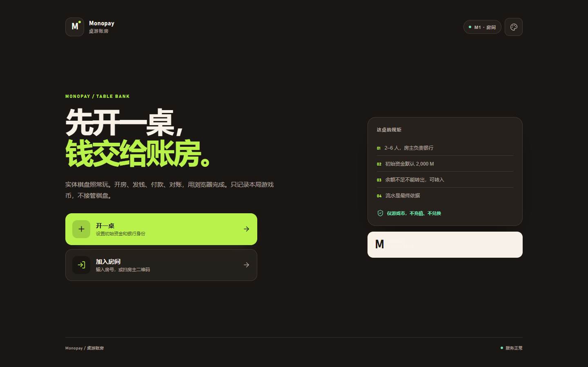
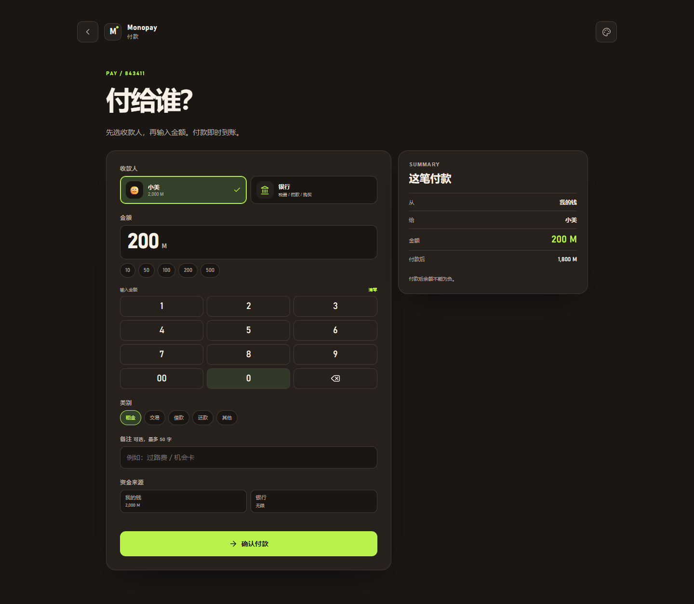
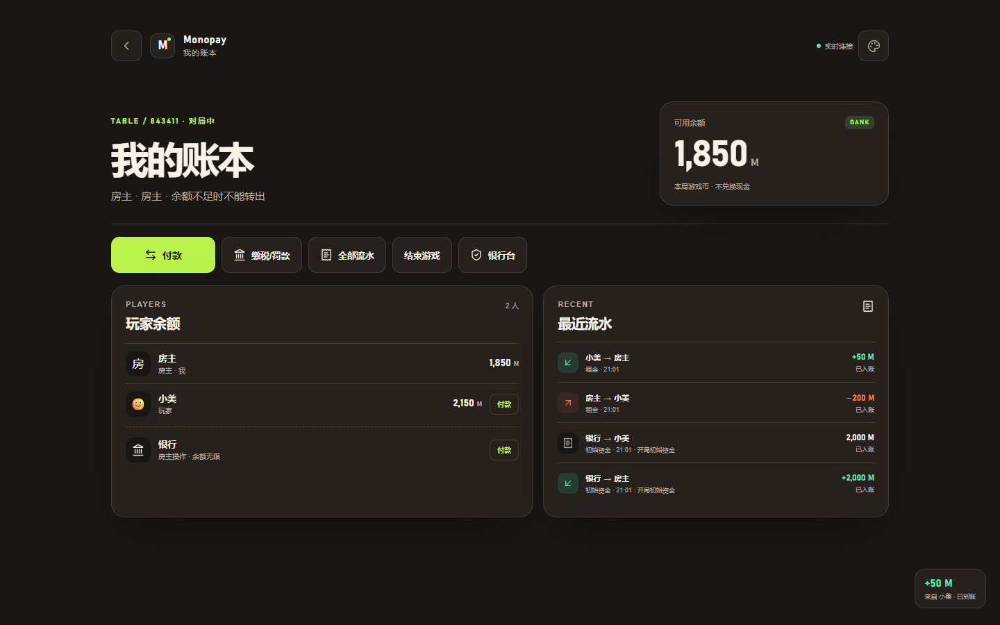
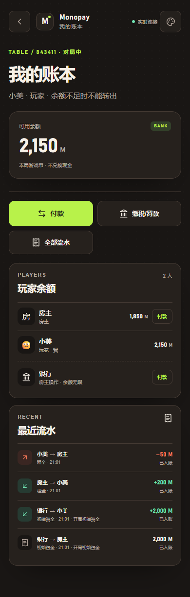

# M4 验收记录

> 日期：2026-11-02 ｜ 阶段：M4 体验与实时打磨
>
> 结论：**本地 M4 通过。** 六套主题、音效/震动、数字键盘、到账反馈、页面过渡、骨架屏、离线提示和 PWA manifest 已接入；规则未改动。服务器部署仍留到最后。

---

## 1. 已完成

| 模块 | 内容 |
|---|---|
| 主题 | A 奶油与钴蓝（默认）+ B–F；`data-theme` 只换 token；localStorage 持久化；F 深色翻转 |
| 主题入口 | 全局 AppHeader 调色盘；不进入房间也能切换；非法值回退 A |
| 音效 | Web Audio 合成，无外部音频；首次 pointerdown 解锁；静音开关持久化 |
| 震动 | 支持 `navigator.vibrate` 的设备；成功/到账短震，错误双震 |
| 到账反馈 | 收款人账本页顶部 toast + 音效；只对收款人触发；开局资金不触发 |
| 数字键盘 | 付款页自绘 1–9/0/00/退格/清零；快捷金额保留 |
| 动效 | 页面 160ms 淡入位移；成功卡 220ms；`prefers-reduced-motion` 关闭 |
| 骨架 | 账本、银行台加载态 skeleton |
| 重连/离线 | WS 状态“实时连接/连接中/离线”；全局离线横幅；回前台刷新快照 |
| 图标/PWA | 纸卡 M favicon；manifest；theme-color 随主题更新 |
| 合规 | 首页、对账页显示“仅使用游戏币 M，不可充值/提现/兑换现金” |

---

## 2. 主题

六套主题全部通过 `data-theme` 切换：

```text
cobalt   奶油与钴蓝（默认）
oats     燕麦与松绿
graphite 石墨与橘
lilac    雾紫与柠檬
salt     海盐与番茄
coffee   咖啡与电光青（深色）
```

M4 浏览器流程逐个切换六套主题并校验 `data-theme`；刷新后仍保持选择。



---

## 3. 交互与反馈

### 数字键盘

付款页不再依赖原生数字输入；金额显示为大字，键盘固定 3 列。



### 到账 toast

小美向房主付款 50 M 后，房主账本出现 `+50 M / 来自小美`，并播放到账音效。



### 深色移动端



---

## 4. 浏览器流程

`pnpm flow:m4`：

```text
首页切换六套主题 → 刷新保持 cobalt
→ 切到 coffee
→ 创建/加入/开始
→ 付款页清零，用键盘输入 200
→ 小美付房主 50
→ 房主收到 toast
→ 1440/390 无横向滚动，0 控制台错误
```

实测：

```text
theme persisted: cobalt
theme: coffee
pay keypad: 1440/1440
host ledger coffee: 1440/1440
player ledger coffee: 390/390
errors: []
```

回归：

```text
pnpm flow:m2  通过
pnpm flow:m3  通过
pnpm flow:m4  通过
```

---

## 5. G4 检查单

- [x] 六套主题切换不改变布局；A 默认；F 深色文字/纸卡可读。
- [x] 390 / 1440 无横向滚动；关键按钮提升到 44px（粗指针设备）。
- [x] 只有收款人触发到账 toast / 音效 / 震动。
- [x] 银行收款静音；普通付款付款方不播成功音；开局资金不播。
- [x] 退款回到原付款人时由原付款人收到反馈。
- [x] 首次 pointerdown 解锁 Web Audio。
- [x] 首次进入和结算页显示游戏币合规文案。
- [x] WS 自动重连；离线横幅；回前台刷新。
- [x] 页面切换 160ms；成功卡动画 220ms；无横向抖动。
- [x] `prefers-reduced-motion` 关闭非必要动画/过渡。
- [x] favicon + manifest；无金币/筹码/黄铜/赌场元素。
- [ ] 768px 设备矩阵截图：本轮做了 390/1440，768 未单独截图。
- [ ] iOS Safari 实机：未验证；使用标准 Web API 与安全区 viewport。
- [ ] 音效去重队列/最多 5 条：当前按单条到账触发，未实现多笔积压队列。

---

## 6. 已知限制

- 没有 Service Worker；manifest 可安装但离线打开不保证。
- 音效受浏览器自动播放策略影响，首次点击后才生效。
- 数字键盘只在付款页；银行台仍使用原生数字输入。
- 没有金额 count-up 和流水 stagger；G4 不强制。
- 主题 B–E 已逐套切换校验，但只保留了 F 的截图。
- 真实 iOS/Android 设备、系统字体差异和震动能力仍需实机验证。
- 服务器部署、HTTPS、持久化仍待最终阶段。

---

## 7. 下一步

M5：产品验收、100/1000 笔重放、并发、限流/CSP/Helmet、SQLite 备份恢复、生产部署、smoke test 与回滚演练。
