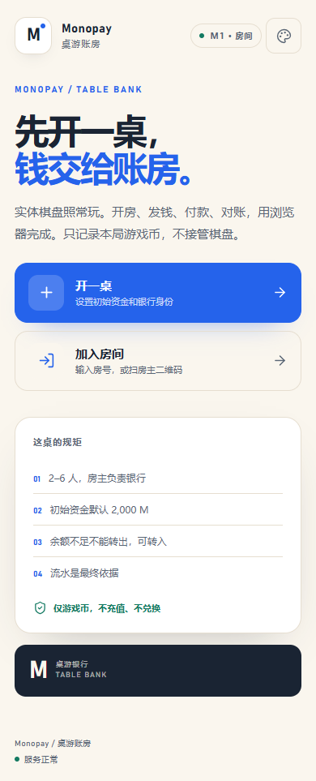
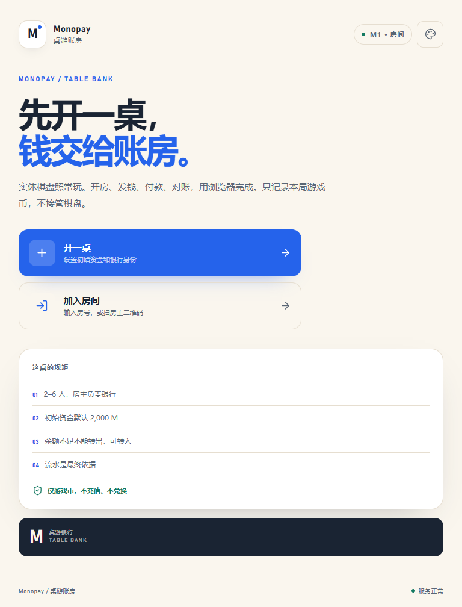
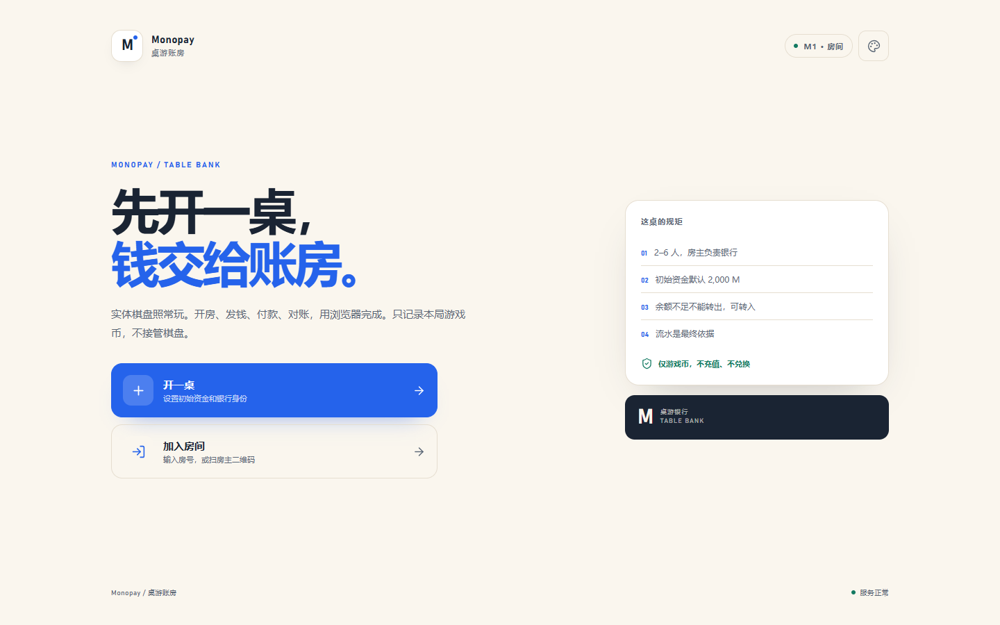

# M5 验收记录

> 日期：2026-11-02 ｜ 阶段：M5 验收、安全与上线准备
>
> 结论：**本地 M5 通过；生产服务器部署待执行。** 功能、数据一致性、安全头、限流、1000 笔重放、6 人并发、备份恢复、重启持久化、390/768/1440 布局均已本地验证。真实 iOS/Android 实机、真实桌游试玩和公网 HTTPS 仍待最终环境。

---

## 1. 本地结果

### 自动测试

```text
ledger-core                 3 passed
server app                  6 passed
room lifecycle              7 passed
corrections / settlement    9 passed
ledger / payment           10 passed
total                      35 passed
```

`pnpm lint`、`pnpm format:check`、`pnpm typecheck`、`pnpm build` 全部通过。

### 1000 笔重放 + 6 人并发

`pnpm load:m5`（本机 Fastify + SQLite + WAL）：

```text
hostBalance: 1000
playerBalance: 3000
sentCount: 1000
latencyMs: p50 5.3 / p95 7.8 / max 39.3
concurrent: 6/6 succeeded
balances: 1500 × 6
```

- 初始 2,000；房主连续付 1,000 笔 × 1 M，余额 1,000。
- 收款人 3,000；流水 `sent` 计数 1,000。
- 6 名玩家同时向银行付 500 M，全部成功，余额均为 1,500。
- 单笔 API 中位 5.3 ms；包含 UI 的完整付款流程见 M2/M4 浏览器流程。

### 备份与恢复

```text
源库：rooms 2 / players 9 / transactions 1014 / assets 0 / settlements 0
备份：monopay-2026-11-02T13-05-22-950Z.db
恢复：rooms 2 / players 9 / transactions 1014 / assets 0 / settlements 0
恢复库 /readyz：200，database: ok
```

- 使用 SQLite Online Backup API，在线备份无需停机。
- 恢复脚本复制到新库并清理 WAL/SHM；恢复实例可启动。
- 默认保留 7 天。

### 重启持久化

```text
创建房间 423918 → 停止进程 → 同 DB 重启
GET /snapshot → 200
room.status = waiting
host nickname = 重启测试
```

### 安全

```text
Content-Security-Policy: default-src 'self'; script-src 'self'; frame-ancestors 'none'
X-Content-Type-Options: nosniff
X-Frame-Options: SAMEORIGIN
Referrer-Policy: no-referrer
Strict-Transport-Security: max-age=31536000; includeSubDomains
pnpm audit --prod: No known vulnerabilities found
```

- 创建/加入：30 次/分钟/IP。
- 付款：1200 次/分钟/IP（支持 1000 笔重放）。
- token 只存 SHA-256 hash；Authorization/Cookie 日志脱敏。
- app 容器：非 root、只读根文件系统、`cap_drop: ALL`、`no-new-privileges`。

### 部署准备

- GHCR 同时发布 `linux/amd64` / `linux/arm64`（v0.1.1）。
- `deploy/compose.yaml` + `.env.example`：app-only、端口可绑定、SQLite 持久化。
- HTTPS 由现有 Nginx/Traefik 等反向代理终止；app 容器不挂证书。
- 运行手册覆盖备份、恢复、回滚、单副本约束。

### 布局

```text
390  inner 390  scroll 390
768  inner 768  scroll 768
1440 inner 1440 scroll 1440
errors: []
```







---

## 2. 功能验收

| 验收项 | 状态 | 证据 |
|---|---|---|
| 房主创建时选银行-only/双身份、初始资金 | 通过 | 创建页/API |
| 房主不能是纯玩家 | 通过 | `hostIdentities` 枚举 |
| 身份创建后不可改 | 通过 | 无修改入口 |
| 银行只房主操作 | 通过 | 403 测试 |
| 2–6 人 URL/扫码/房号加入 | 通过 | M1 + 6 人测试 |
| 开局初始资金一次 | 通过 | 重复 start 409 |
| 玩家/银行收付、余额不足 | 通过 | M2 测试 |
| 工资默认 200、可改、不二次确认 | 通过 | 银行台 |
| 机会卡银行收付 | 通过 | 类别 chance |
| 流水筛选/详情 | 通过 | M3 |
| 退款收款方、冲正房主 | 通过 | M3 |
| 双身份切换不改变余额/名额 | 通过 | 双身份测试 |
| 净资产结算、并列、破产、只读 | 通过 | M3 |
| 结算中退款/冲正/资产；返回 playing | 通过 | 服务允许 + 测试 |
| 银行-only 不排名 | 通过 | 结算测试 |
| 破产取消恢复主动付款 | 通过 | 破产测试 |
| 付款人在线 | 客户端离线禁用；服务端无 presence 校验 | 见限制 |
| 服务器重启房间恢复 | 通过 | 重启测试 |
| 累计发行/回收 | 通过 | 银行台 |
| 断线重连余额/流水 | 通过 | M1/M4 |
| 只有收款人音效/横幅/震动 | 通过 | M4 |
| 银行收款静音 | 通过 | M4 |
| 结算后只读 | 通过 | M3 |
| 100 笔/1000 笔一致 | 通过 | 单测 + 压测 |
| 幂等/防重复扣款 | 通过 | 幂等测试 |
| 冲正保留原流水 | 通过 | M3 |
| 负余额保护 | 通过 | 扣款校验 |
| seq 单调、双方余额 | 通过 | 单测 |
| 手机可读、关键按钮 | 通过 | 390/768/1440 |
| 无真实货币/充值入口 | 通过 | 文案审查 |
| 隐私/删除说明 | 通过 | `隐私与数据删除.md` |

---

## 3. 未完成 / 待最终环境

- [ ] 生产服务器公网 HTTPS（需域名、服务器、SSH/Compose 权限）。
- [ ] Docker 镜像在本机运行验证（本机无 Docker；由 GitHub Actions 构建）。
- [ ] iPhone Safari / Android Chrome 实机。
- [ ] 2–3 局真实桌游试玩。
- [ ] 收款人 1 秒内到账的正式计时（本地 WS 正常，未做统计）。
- [ ] 服务端“付款人必须在线”的 presence 校验（客户端离线禁用，API 无在线态）。
- [ ] 生产备份异地复制与定时任务实际运行。

---

## 4. 下一步

提交 M5 本地改动 → 推送 main → 打 `v0.1.0` tag → 等 GHCR 镜像 → 在用户提供的服务器执行 `docs/部署运行手册.md`，完成 HTTPS、smoke test、备份、回滚演练。
